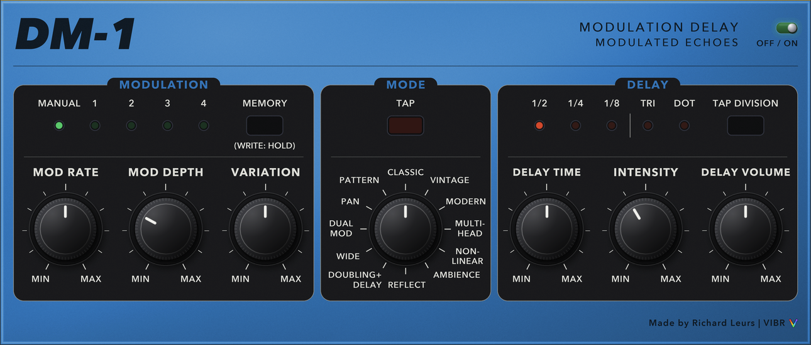

Are you interested in audio plugins and want to help improving and expanding the plugins then send me a message.

# VIBR Audio Plugins

A collection of Vintage effects pedals (and some new) redesigned as audio plugins (VST3, Audio Unit and Standalone), vibe coded with JUCE 8 and C++20.



### Delay & Echo

| Plugin | What it is |
|---|---|
| DD-1 Dual Delay | two delays + shimmer reverb, boost, chorus, hall reverb, 4 panel memories; compact two-tab window (DELAY: tempo, delay A, stereo, delay B / EFFECTS: boost, ambience, shimmer) |
| DM-1 Delay Machine | 12-mode modulation delay, tap division, 4 panel memories |
| RE-2 Space Echo | tape echo + spring reverb, saturation, guitar / line, new / aged tape, 4 panel memories |
| MM-1 Analog Delay | analog-style delay, chorus and vibrato |
| SD-1 Digital Delay | digital delay: time, factor, regeneration, hi-cut, modulation, headroom meter |
| RV-1 Reverse Lab | creative time manipulation: reverse, tape scrub, stutter, glitch and repeat modes, freeze; length (free or synced to the host tempo), speed, smooth, random, repeats, mix, level; on the shared Lab UI with presets, A / B and undo |

### Modulation

| Plugin | What it is |
|---|---|
| CE-1 Chorus Ensemble | chorus / vibrato |
| BF-3 Flanger | stereo flanger: manual, res, depth, rate, 3 modes (standard, ultra, gate / pan) |
| PH-2 Phaser | phaser: rate, depth, res, 2 modes (4 or 8 stages) |
| TR-2 Tremolo | tremolo: rate, depth, wave (sine to square) |
| VC-1 Voltage Controller | modulation matrix: envelope follower, two LFOs, random and MIDI (mod wheel / expression) sources routed to filter, amp, vibrato and pan with cross-modulation; the rates can sync to the host tempo |
| VR-1 Vibe and Rotary | three swirling modulation effects: uni-vibe (chorus / vibrato type, tempo sync), a rotary speaker (slow / fast horn and drum) and ring mod (sine / triangle / square carrier), with a live picture of the effect |
| ML-1 Modulation Lab | chorus, vibrato, flanger and phaser in one plugin, driven by one LFO with tempo sync, with a live picture of the effect (the delay of every voice, the pitch bend, the comb of the flanger, the notches of the phaser); on the shared Lab UI with presets, A / B and undo |
| DL-1 Delay Lab | the first Lab: the SD-1 digital delay, the MM-1 analog delay, a new tape delay (1 to 3 heads, wow and flutter, saturation, age) a dual delay (A and B, parallel or series) and the 12 DM-1 modulation voicings as modes of one plugin, tempo sync, low cut and hi cut in the loop, ping-pong spread, hold, tap tempo, a display of the repeats where the first one is dragged to set the time, presets, A / B and undo; built on the shared UI of `src/common/ui` |
| DN-1 Dynamics Lab | the second Lab, as modes of one plugin: the DY-1 shaper (gate, expander, transient shaper), a compressor (SUSTAIN = the CS-3, a clean VCA, a program-dependent OPTO) and a limiter (PEAK = the LM-2, TRUE PEAK with lookahead from the MS-1); side-chain high-pass, stereo link, parallel mix, auto level, a constant latency in every mode, and a display of the input level and the gain over five seconds |
| DV-1 Drive Lab | the third Lab, as modes of one plugin: the OD-2 overdrive (12 types, 3-band tone, gate), the DS-1 distortion (classic and modern), tube (single and push-pull), tape (new and aged), fold (transistor and foldback) and crush (hard and smooth); boost, auto level, mix, 4x oversampling with a constant latency, and a display of the transfer curve and the waveform |
| RH-1 Rhythm Lab | the fourth Lab: one control engine (LFO, envelope follower, 16-step lane with glide and swing, host tempo and position sync) that moves a filter (the MF-1: low / band / high pass, notch, vowel), a tremolo (the TR-2, harmonic and panner variants) or a slicer (the SL-2: single, dual, tremolo, SFX, harmonic, 11 patterns); a paintable step lane and a display of the control signal and its target |
| RB-1 Reverb Lab | the fifth and last Lab: the BS-1 reverb (12 types), the SP-1 space engine (shimmer, infinite, spectral, modulated, rooms) and the SR-1 sympathetic resonator (strings tuned to a scale; wood, metal, glass) as modes of one plugin, with a shared pre-delay, ducking, freeze, mix and level and a display of the tail |

### Drive

| Plugin | What it is |
|---|---|
| DS-1 Distortion | stompbox distortion: tone, level, dist |
| SA-1 Lo-Fi Saturator | boost, tube, tape and bit crusher in one chain, each with its own on / off switch: boost gain and tone, tube drive and bias, tape drive and warmth, bits, sample rate and mix, with a live picture of the transfer curve and the waveform |
| OD-2 Hybrid Drive | 12 drive types, 3-band tone, boost, noise gate, 4 panel memories |

### Dynamics

| Plugin | What it is |
|---|---|
| CS-3 Compression Sustainer | compressor / sustainer: level, tone, attack, sustain |
| LM-2 Limiter | peak limiter: level, tone, release, threshold |
| DY-1 Dynamic Shaper | noise gate, expander and transient shaper in one chain, each with its own on / off switch: thresholds, ratio, releases, attack and sustain, with a live display of the input level and the gain of the chain |

### EQ

| Plugin | What it is |
|---|---|
| GE-7 Equalizer | graphic equalizer: 7 bands (100 Hz - 6.4 kHz, +-15 dB) and a level fader |
| EH-2 Enhancer | treble enhancer: mix (inverting), freq, sens |
| HM-2 Harmonic Machine | adds and reshapes harmonics: tube / tape / transistor / fold saturation, odd / even balance, octave up and sub octave, frequency-dependent drive |
| MF-1 Motion Filter | a filter moved by an LFO, an envelope follower or an 8-step sequencer: low / band / high pass, notch and vowel (formant) filters, tempo sync, glide |

### Amp & Cabinet

| Plugin | What it is |
|---|---|
| IR-2 Amp & Cabinet | amp and cabinet: 11 amp types, gain, level, bass / middle / treble, ambience |
| MA-1 Metal Amp and Cabinet | modern-metal rig: noise gate, tight boost, 4 amp voicings (8x oversampled), two impulse-response cabinets (load your own WAVs), EQ and limiter |

### Pitch

| Plugin | What it is |
|---|---|
| OC-5 Octave | vintage (monophonic) and poly octave: direct, +1 oct, -1 oct, -2 oct range |
| GR-1 Grain | granular processing of the playing: grain size, density, position, spray, pitch (with random), reverse, spread, freeze, tempo sync for the density, live grain-cloud display (scrolls with time) |
| PT-1 Phantom | four-voice harmonizer: interval, detune, level per voice; intelligent mode keeps the harmonies in key and scale (pitch detection); chord presets |

### Reverb

| Plugin | What it is |
|---|---|
| BS-1 Reverb | 12 reverb types (room, hall, plate, spring, swell, bloom, cloud, chorale, shimmer, magneto, nonlinear, reflections) |
| SP-1 Space Engine | experimental spaces: shimmer, infinite, spectral, modulated and rooms modes, freeze; size, decay, diffusion, tone, motion, texture, mix, level |
| SR-1 Sympathetic Resonator | up to 12 virtual strings tuned to a scale that ring along with the playing; wood / metal / glass textures, decay, damping, tension, motion |
| SU-1 Stereo Utility | invert, swap, mono and mid / side solo; width, spread and bass mono; pan with an auto-pan; gain; a live field display with level bars, a goniometer and the phase correlation |

### Rhythm

| Plugin | What it is |
|---|---|
| SL-2 Slicer | rhythmic slicer: 11 patterns, 5 modes, tempo from the knob or the host |

### Multi effect

| Plugin | What it is |
|---|---|
| ME-1 Multi Effect | build your own chain from 39 basic effect modules with 2-3 knobs each: any number in a chain, drag to reorder, bypass, replace, tempo sync on the time and rate knobs; self-contained (it does not use the pedals above) |

### Mastering

| Plugin | What it is |
|---|---|
| MS-1 Mastering Suite | version 0.8 of the mastering suite (`src/mastering`): an 8-band minimum-phase corrective EQ (low shelf, six bells, high shelf; each band Stereo / Left / Right / Mid / Side, optional dynamic gain, minimum or linear phase; draggable nodes over the spectrum; match EQ fits it to a reference), a 4-band multiband compressor (Linkwitz-Riley crossovers, per band threshold / ratio / attack / release or auto / make-up / solo), a 3-band stereo imager (width per band, mono-below, mid / side balance, auto safe width, goniometer and correlation meter), a colour stage (tape / tube / transformer saturation in 4x oversampling, tone, mid / side, mix), a VCA-style stereo-linked bus compressor (ratio 1.5 - 10:1, attack 0.1 - 30 ms, release 0.1 - 1.2 s or auto, make-up, parallel mix, sidechain high-pass, gain reduction history), a true-peak-safe lookahead limiter with a loudness target (auto gain to a LUFS value), input trim (gain, polarity, rumble high-pass, mono check), dither with noise shaping, and honest meters: momentary / short-term / integrated loudness and loudness range (ITU-R BS.1770-4, checked against the EBU Tech 3341 / 3342 signals), sample peak, RMS, crest, PLR, PSR and a DR value, short-term and integrated phase correlation, a goniometer, 8x true peak and a before / after spectrum; target presets for streaming, CD, broadcast and more. The multiband compressor, stereo imager, saturation follow; a reference track (WAV / AIFF / FLAC / MP3, level matched, A / B switch, spectrum overlay, own transport that can follow the host) is built in, with factory and user presets, A / B slots and 100-step undo / redo (see `.claude/mastering_specs.md`) |

**ME-1 modules** 

| Group | Modules |
|---|---|
| Delay & Echo | delay, echo, mod delay, ping-pong, reverse |
| Modulation | chorus, vibrato, uni-vibe, rotary, flanger, phaser, ring mod, tremolo, slicer |
| Drive | overdrive, distortion, fuzz, tape, tube, bit crusher, boost |
| Dynamics | compressor, sustainer, limiter, noise gate, expander, transient shaper, volume |
| Filter & EQ | filter, EQ, enhancer, auto wah |
| Pitch | octave, pitch shifter |
| Space | reverb, spring, shimmer, pan, stereo spreader |

The window has a strip of tiles at the top (one per module, coloured by group, with a bypass lamp and a remove cross; `+` adds a module, drag a tile to reorder, the wheel scrolls a long chain) and the selected module's knobs below. Delay and LFO modules have a SYNC button that makes the time or rate knob follow the host tempo (120 bpm when the host gives none). Input, output and power are host parameters; the module settings are saved in the session. No presets yet.


You can find the web page for the project on this [`website`](https://vibr.richardleurs.nl).

## Build

### What you need

The build is set up for macOS (the copy and signing steps use `codesign`, `xattr` and `~/Library/Audio/Plug-Ins`).

| Tool | Version | How to get it |
|---|---|---|
| Xcode Command Line Tools (compiler, `git`, `codesign`) | recent | `xcode-select --install` |
| CMake | 3.22 or newer | `brew install cmake` ([Homebrew](https://brew.sh)), or the installer from [cmake.org/download](https://cmake.org/download/) |
| JUCE | 8.0.3 | see below |
| Python 3 with `numpy` and `Pillow` | only to re-render the front-panel artwork (`make_background.py`) | `pip install numpy pillow` |

**JUCE.** The plugins are written for JUCE 8.0.3 (C++20). The easiest way is to clone it once into `~/Developer/JUCE`, where the build finds it automatically:

```bash
git clone --depth 1 --branch 8.0.3 https://github.com/juce-framework/JUCE.git ~/Developer/JUCE
```

Keep it outside iCloud-synced folders such as `~/Documents`, where files can be evicted to the cloud and reads stall. If `~/Developer/JUCE` does not exist, CMake downloads JUCE 8.0.3 from GitHub by itself (`FetchContent`), which needs an internet connection and takes longer on a fresh build. You can point to another checkout with `cmake -DFETCHCONTENT_SOURCE_DIR_JUCE=/path/to/JUCE ...`.

**Signing (optional).** After each build the bundles are signed with a self-signed certificate if it exists in your login keychain; otherwise they get an ad-hoc signature, which is fine for your own machine.

### Building

The build on macOS is placed outside the iCloud synced folders in `~/Developer/VIBR`.

```bash
./build.sh                  # everything, for this Mac's architecture
./build.sh --arch x86_64    # everything for Intel Macs (arm64 and x86_64 are separate builds, so each bundle stays small)
./build.sh --arch win64     # on Windows (Git Bash, Visual Studio 2022, CMake): VST3 and Standalone in ~/Developer/VIBR/releases/win64 and zips in ~/Developer/VIBR/zip (no AU on Windows)
./build.sh --arch all       # both, one after the other
./build.sh DD-1 SD-1        # only these plugins
./build.sh --clean          # rebuild from scratch
```

The signed bundles of each architecture are collected in `~/Developer/VIBR/releases/<arch>/{effects,drumcomputer,multieffect}/{VST3,AU,Standalone}`, with `<arch>` = `arm64` or `x86_64`. Only this Mac's own architecture is installed in `~/Library/Audio/Plug-Ins`; the other one is just collected, so copy it to a Mac of that type.

`build.sh` configures and builds into `~/Developer/VIBR` (outside iCloud; the x86_64 build tree is `~/Developer/VIBR-x86_64`); it is a thin wrapper around:

```bash
cmake -S . -B ~/Developer/VIBR -DRL_ARCH=arm64 -DRELEASES_DIR=~/Developer/VIBR/releases/arm64
cmake --build ~/Developer/VIBR --config Release -j8
```

One plugin: `--target DD-1_All` (or `DM-1_All`, `CE-1_All`, `RE-2_All`, `DS-1_All`, `BF-3_All`, `CS-3_All`, `LM-2_All`, `PH-2_All`, `TR-2_All`, `GE-7_All`, `EH-2_All`, `IR-2_All`, `MA-1_All`, `ME-1_All`, `TR-8_All`, `SL-2_All`, `OD-2_All`, `OC-5_All`, `BS-1_All`, `MM-1_All`, `SD-1_All`, `SP-1_All`, `RV-1_All`, `MF-1_All`, `HM-2_All`, `GR-1_All`, `SR-1_All`, `VC-1_All`, `PT-1_All`, `VR-1_All`, `DY-1_All`, `SA-1_All`, `SU-1_All`, `ML-1_All`, `DL-1_All`, `DN-1_All`, `DV-1_All`, `RH-1_All`, `RB-1_All`, `MS-1_All`, ...).

### Screenshots for the website

`tools/screenshot` has a small app per plugin (`Shot-DY-1`, `Shot-SU-1`, `Shot-SA-1`, `Shot-MS-1`, `Shot-ML-1`, `Shot-VR-1`; add a plugin to the list in `tools/screenshot/CMakeLists.txt`). It loads the plugin, sets parameters, plays a test signal into it (so the meters and displays show something) and writes the editor to a PNG at its own size, the same size as the images in `website/img`:

```bash
cmake --build ~/Developer/VIBR --target Shot-DY-1
~/Developer/VIBR/tools/screenshot/Shot-DY-1_artefacts/Release/Shot-DY-1.app/Contents/MacOS/Shot-DY-1 website/img/dy-1.png stepTone 6 gateOn=1 expOn=0 transOn=1
~/Developer/VIBR/tools/screenshot/Shot-SU-1_artefacts/Release/Shot-SU-1.app/Contents/MacOS/Shot-SU-1 website/img/su-1.png lissajous 6 pan=-20 autoDepth=30 spread=40 bassMono=120
```

Signals: `silence`, `tone`, `stepTone`, `lissajous`, `noise` (see `ScreenshotTool.cpp`); arguments after the seconds are `parameterID=value` in the plain (host) range.

## License

Copyright © 2026 Richard Leurs

This program is free software: you can redistribute it and/or modify it under the terms of the **GNU General Public License, version 3**, as published by the Free Software Foundation. It is distributed in the hope that it will be useful, but **without any warranty**; without even the implied warranty of merchantability or fitness for a particular purpose. See the [`LICENSE`](LICENSE) file for the full text.

The plugins are built with [JUCE 8](https://juce.com), used under its open-source licence (AGPLv3). The designs are inspired by classic hardware but are independent and carry no third-party branding; product names mentioned belong to their respective owners. The TR-08 sample kits are not part of this repository.
