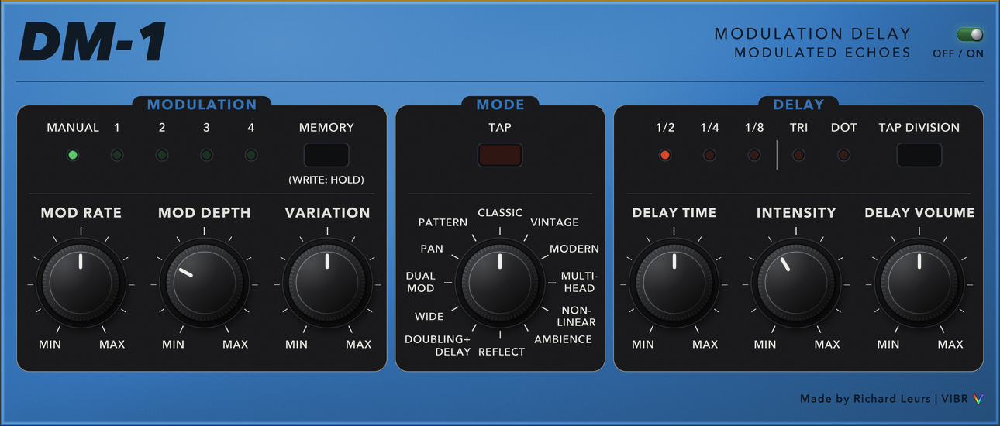

[](https://github.com/RichardLeurs/VIBR-audio-plugins/actions/workflows/windows.yml)
[](https://github.com/RichardLeurs/VIBR-audio-plugins/actions/workflows/macos.yml)
[](https://github.com/RichardLeurs/VIBR-audio-plugins/actions/workflows/linux.yml)
[](https://github.com/RichardLeurs/VIBR-audio-plugins/actions/workflows/linux.yml)

Are you interested in audio plugins and want to help improving and expanding the plugins then send me a message.
You can find the web page for the project on this [`website`](https://vibr.richardleurs.nl).

# VIBR Audio Plugins

A collection of guitar effects inspired by iconic vintage pedals and original experimental designs. From timeless tones and familiar textures to unconventional soundscapes and creative effects, VIBR brings together the character of classic hardware and the freedom of modern audio processing.

VIBR is open source by design. Every plugin, its code and artwork are free to explore, modify and share. Made for creativity, collaboration and a shared passion for audio.



### Delay & Echo

| Plugin | What it is |
|---|---|
| DD-1 Dual Delay | two delays + shimmer reverb, boost, chorus, hall reverb, 4 panel memories; compact two-tab window (DELAY: tempo, delay A, stereo, delay B / EFFECTS: boost, ambience, shimmer) |
| DM-1 Delay Machine | 12-mode modulation delay, tap division, 4 panel memories |
| RE-2 Space Echo | tape echo + spring reverb, saturation, guitar / line, new / aged tape, 4 panel memories |
| MM-1 Analog Delay | analog-style delay, chorus and vibrato |
| SD-1 Digital Delay | digital delay: time, factor, regeneration, hi-cut, modulation, headroom meter |

### Modulation

| Plugin | What it is |
|---|---|
| CE-1 Chorus Ensemble | chorus / vibrato |
| BF-3 Flanger | stereo flanger: manual, res, depth, rate, 3 modes (standard, ultra, gate / pan) |
| PH-2 Phaser | phaser: rate, depth, res, 2 modes (4 or 8 stages) |
| TR-2 Tremolo | tremolo: rate, depth, wave (sine to square) |
| ML-1 Modulation Lab | seven modes in one plugin: chorus, vibrato, flanger and phaser driven by one LFO with tempo sync, plus the former VR-1 effects: UNI-VIBE (four all-pass stages, chorus / vibrato type, tempo sync), ROTARY (speaker with horn and drum, slow / fast, speeds that ramp) and RING MOD (sine / triangle / square carrier). A live picture per mode (the delay of every voice, the pitch bend, the comb of the flanger, the notches of the phaser, the stages sliding along a frequency axis, the turning drum and horn, the input / carrier / result waves); on the shared Lab UI with presets, A / B and undo |
| DL-1 Delay Lab | the first Lab: the SD-1 digital delay, the MM-1 analog delay, a new tape delay (1 to 3 heads, wow and flutter, saturation, age) a dual delay (A and B, parallel or series) and the 12 DM-1 modulation voicings as modes of one plugin, tempo sync, low cut and hi cut in the loop, ping-pong spread, hold, tap tempo, a display of the repeats where the first one is dragged to set the time, presets, A / B and undo; built on the shared UI of `src/common/ui` |
| DN-1 Dynamics Lab | the second Lab, as modes of one plugin: a shaper (gate, expander, transient shaper), a compressor (SUSTAIN = the CS-3, a clean VCA, a program-dependent OPTO) and a limiter (PEAK = the LM-2, TRUE PEAK with lookahead from the MS-1); side-chain high-pass, stereo link, parallel mix, auto level, a constant latency in every mode, and a display of the input level and the gain over five seconds |
| DV-1 Drive Lab | the third Lab, as modes of one plugin: the OD-2 overdrive (12 types, 3-band tone, gate), the DS-1 distortion (classic and modern), tube (single and push-pull), tape (new and aged), fold (transistor and foldback) and crush (hard and smooth), CHAIN (boost, tube, tape and crush in series, each with its own switch) and HARMONICS (octave up, sub octave, odd / even balance, frequency-dependent drive); boost, auto level, mix, 4x oversampling with a constant latency, and a display of the transfer curve and the waveform |
| RH-1 Rhythm Lab | the fourth Lab: one control engine (LFO, envelope follower, 16-step lane with glide and swing, host tempo and position sync) that moves a filter (low / band / high pass, notch, vowel, glide), a tremolo (the TR-2, harmonic and panner variants) a slicer (the SL-2: single, dual, tremolo, SFX, harmonic, 11 patterns) or a MATRIX (envelope follower, two LFOs, random and the MIDI mod wheel, expression and pressure routed to filter, amp, vibrato and pan); a paintable step lane and a display of the control signal and its target |
| RB-1 Reverb Lab | the fifth and last Lab: the BS-1 reverb (12 types), a space engine (shimmer, infinite, spectral, modulated, rooms) and a sympathetic resonator (strings tuned to a scale; wood, metal, glass) as modes of one plugin, with a shared pre-delay, ducking, freeze, mix and level and a display of the tail |

### Drive

| Plugin | What it is |
|---|---|
| DS-1 Distortion | stompbox distortion: tone, level, dist |
| OD-2 Hybrid Drive | 12 drive types, 3-band tone, boost, noise gate, 4 panel memories |

### Dynamics

| Plugin | What it is |
|---|---|
| CS-3 Compression Sustainer | compressor / sustainer: level, tone, attack, sustain |
| LM-2 Limiter | peak limiter: level, tone, release, threshold |

### EQ

| Plugin | What it is |
|---|---|
| GE-7 Equalizer | graphic equalizer: 7 bands (100 Hz - 6.4 kHz, +-15 dB) and a level fader |
| EH-2 Enhancer | treble enhancer: mix (inverting), freq, sens |

### Amp & Cabinet

| Plugin | What it is |
|---|---|
| AL-1 Amp Lab: Raw Power | the amp lab (replaces the former MA-1 and IR-2): 14 amp types (the 11 of IR-2 and MODERN, BRUTAL, ULTRA), input trim, noise gate, tight boost, gain / tone stack / presence / resonance / sag / master, bright and deep, 4x oversampling with a constant latency, two impulse-response cabinets (load your own WAVs, saved in the session) or a filter model with a mic position, low / high cut, EQ, ambience room, output and limiter, factory and user presets, undo, MIDI learn; displays of the amp curve, the cabinet response and the meters |

### Pitch

| Plugin | What it is |
|---|---|
| OC-5 Octave | vintage (monophonic) and poly octave: direct, +1 oct, -1 oct, -2 oct range |
| SF-1 Spectral Fold | spectral processor (phase vocoder, experimental) with a second mode, HARMONY (four-voice harmonizer with interval, detune and level per voice, intelligent key and scale mode). FOLD is the spectral processor: FREEZE the whole spectrum or one of four bands and CAPTURE a snapshot to MORPH towards; SMEAR and BLUR the magnitudes over time and frequency; SHIFT every partial by a number of Hz (SPREAD moves left and right apart), RING modulation, spectral FEEDBACK, DRIFT of the frozen partials and a moving WINDOW that scans and isolates frequency regions; live SPECTRUM display, presets, A / B and undo; one frame (2048 samples) of latency |
| TF-1 Time Fracture | time lab (experimental) with three modes, STEPS, SCRUB (reverse, tape scrub, stutter, speed) and GRAINS (granular cloud with freeze and tempo sync). STEPS is a rhythmic glitch instrument: the input is recorded all the time into a rolling buffer (HOLD stops it); a 16-step pattern locked to the host tempo and position (or the TEMPO knob) gives every step an operation: REPEAT (stutter, micro-loop), REVERSE, SCRAMBLE (a random slice of the last steps), PITCH (random pitch jumps), STRETCH (grains, the pitch stays), MUTE or PLAY; CHANCE replaces steps by random operations, CRUSH reduces bits and sample rate; division 1/4 to 1/32 and triplets, pattern length, CLEAR / RANDOM, BUFFER display, presets, A / B and undo; no latency |
| IC-1 Infinite Circuit | feedback network (experimental): four nodes, each a delay line with an all-pass phase stage, a resonant low / band / high-pass filter and a saturator, wired through six routings (PARALLEL, SERIES, PING-PONG, CASCADE, MESH, STAR) with CROSS-feedback between the channels, an independent feedback level per node, TIME and SPREAD of the node delays, three input paths, REGEN, SELF-OSC (loop gain above 1), HOLD (endless sustain), EXCITE (a burst to start an oscillation), a modulation inside the loop and DRIVE; live NETWORK display of the nodes and their feedback paths, presets, A / B and undo; no latency |

### Reverb

| Plugin | What it is |
|---|---|
| BS-1 Reverb | 12 reverb types (room, hall, plate, spring, swell, bloom, cloud, chorale, shimmer, magneto, nonlinear, reflections) |
| SU-1 Stereo Utility | invert, swap, mono and mid / side solo; width, spread and bass mono; pan with an auto-pan; gain; a live field display with level bars, a goniometer and the phase correlation |

### Rhythm

| Plugin | What it is |
|---|---|
| SL-2 Slicer | rhythmic slicer: 11 patterns, 5 modes, tempo from the knob or the host |

### Mastering

| Plugin | What it is |
|---|---|
| MS-1 Mastering Suite | an 8-band minimum-phase corrective EQ (low shelf, six bells, high shelf; each band Stereo / Left / Right / Mid / Side, optional dynamic gain, minimum or linear phase; draggable nodes over the spectrum; match EQ fits it to a reference), a 4-band multiband compressor (Linkwitz-Riley crossovers, per band threshold / ratio / attack / release or auto / make-up / solo), a 3-band stereo imager (width per band, mono-below, mid / side balance, auto safe width, goniometer and correlation meter), a colour stage (tape / tube / transformer saturation in 4x oversampling, tone, mid / side, mix), a VCA-style stereo-linked bus compressor (ratio 1.5 - 10:1, attack 0.1 - 30 ms, release 0.1 - 1.2 s or auto, make-up, parallel mix, sidechain high-pass, gain reduction history), a true-peak-safe lookahead limiter with a loudness target (auto gain to a LUFS value), input trim (gain, polarity, rumble high-pass, mono check), dither with noise shaping, and honest meters: momentary / short-term / integrated loudness and loudness range (ITU-R BS.1770-4, checked against the EBU Tech 3341 / 3342 signals), sample peak, RMS, crest, PLR, PSR and a DR value, short-term and integrated phase correlation, a goniometer, 8x true peak and a before / after spectrum; target presets for streaming, CD, broadcast and more. The multiband compressor, stereo imager, saturation follow; a reference track (WAV / AIFF / FLAC / MP3, level matched, A / B switch, spectrum overlay, own transport that can follow the host) is built in, with factory and user presets, A / B slots and 100-step undo / redo (see `.claude/mastering_specs.md`) |

## If macOS blocks the plugins

When you download an unsigned or unofficially distributed app or plugin, macOS may attach a quarantine attribute (`com.apple.quarantine`). This can trigger Gatekeeper warnings such as:

- "App is damaged and can't be opened."
- "Apple could not verify that this app is free of malware."

Running `xattr -cr` removes that metadata and allows the app to launch:

```
xattr -cr /Applications/MyApp.app
```

If you only want to remove the quarantine flag:

```
xattr -dr com.apple.quarantine /Applications/MyApp.app
```

For the plugins, run it on the unzipped bundles, for example on the VST3 and AU folders in `~/Library/Audio/Plug-Ins`:

```
xattr -dr com.apple.quarantine ~/Library/Audio/Plug-Ins/VST3 ~/Library/Audio/Plug-Ins/Components
```

## MIDI

26 effects read MIDI, plus TR-08 (the effects never write or change it, the MIDI passes through unchanged). Every knob listed in a plugin can be bound to any CC: right-click the knob, choose **MIDI learn**, move a controller. A pulsing ring shows the knob waiting for a CC and a small dot under the knob shows a bound CC. **Clear MIDI** removes the binding; **Soft takeover** ignores a CC until it passes the knob, so it does not jump. The bindings are saved with the session (not with presets). A CC bound to the rate or time knob moves the note division while SYNC is on. In a host, the plugin needs its MIDI input enabled (on a Logic or Ableton track, choose the controller as the MIDI source of the effect).

Default CCs (all channels; everything else through MIDI learn):

| Plugin | CC1 (mod wheel) | CC11 (expression) | CC64 (sustain) |
|---|---|---|---|
| RE-2 | intensity | repeat rate | |
| MM-1 | depth | delay | |
| SD-1 | mod intensity | delay time | |
| DM-1 | mod depth | delay time | |
| DD-1 | delay A repeats | delay A time | |
| DL-1 | mod depth | time | hold |
| SF-1 | morph | smear | freeze |
| TF-1 | chance | loop | hold |
| RH-1 MATRIX | mod wheel source | expression source | |
| IC-1 | regen | cutoff | hold |
| TR-2, PH-2, BF-3, ML-1, RH-1 | depth | rate | |

ML-1: CC1 and CC11 move DEPTH (INTENSITY in UNI-VIBE) and RATE (SPEED in ROTARY, FREQ in RING MOD) in every mode; the same `rate`, `depth`, `extra`, `mix`, `level` parameters, no new CC targets (the third knob WIDTH / FEEDBACK exists in the four original modes only). The mode, type and sync switches are not CC targets.

| CE-1 | vibrato depth | vibrato rate | |
| RB-1 | motion | decay | freeze |
| OC-5 | +1 oct level | -1 oct level | |
| DV-1, OD-2, DS-1 | | drive (DS-1: dist) | |
| AL-1 | presence | gain | |
| DN-1 | | gate threshold | |
| CS-3 | | sustain | |
| LM-2 | | threshold | |

RH-1 MATRIX also reads the mod wheel, expression and channel pressure as modulation sources; TR-08 plays its drums from MIDI notes and keeps its own fixed map. MS-1, ME-1 and the plugins not listed above do not take MIDI.

**Tap tempo.** DM-1, DL-1, DD-1, RE-2, MM-1 and SD-1 tap the tempo from any MIDI note-on or from CC85 (a rising edge, value 64 or higher), with the same averaging as the TAP button; RE-2, MM-1 and SD-1 have no TAP button, only MIDI. A tap turns SYNC off (DM-1 ignores taps while SYNC is on).

The shared code is `src/common/MidiMap.h` (CC map, learn, soft takeover, tap flag), `MidiTarget.h` (learn target over code-drawn switches) and `TapTempo.h`. Its unit test: `cmake --build ~/Developer/VIBR --target MidiMapTest`, then run `~/Developer/VIBR/tools/midi-test/MidiMapTest_artefacts/Release/MidiMapTest` (exit code 0 = all checks passed).

## Build

### What you need

The build is set up for macOS (the signing step uses `codesign`). `build.sh` also builds on Windows (`--arch win64` or `--arch winarm64`, Git Bash and Visual Studio 2022) and on Linux (`linux64` / `linuxarm64`, VST3 and Standalone only, see [INSTALL.md](INSTALL.md)). Nothing is installed by the build: the bundles are only collected in `~/Developer/VIBR/releases` (see below).

| Tool | Version | How to get it |
|---|---|---|
| Xcode Command Line Tools (compiler, `git`, `codesign`) | recent | `xcode-select --install` |
| CMake | 3.22 or newer | `brew install cmake` ([Homebrew](https://brew.sh)), or the installer from [cmake.org/download](https://cmake.org/download/) |
| JUCE | 8.0.3 | see below |
| Python 3 with `numpy` and `Pillow` | only to re-render the front-panel artwork (`make_background.py`) | `pip install numpy pillow` |

**JUCE.** The plugins are written for JUCE 8.0.3 (C++20). The easiest way is to clone it once into `~/Developer/JUCE`, where the build finds it automatically:

```bash
git clone --depth 1 --branch 8.0.3 https://github.com/juce-framework/JUCE.git ~/Developer/JUCE
```

Keep it outside iCloud-synced folders such as `~/Documents`, where files can be evicted to the cloud and reads stall. If `~/Developer/JUCE` does not exist, CMake downloads JUCE 8.0.3 from GitHub by itself (`FetchContent`), which needs an internet connection and takes longer on a fresh build. You can point to another checkout with `cmake -DFETCHCONTENT_SOURCE_DIR_JUCE=/path/to/JUCE ...`.

**Signing (optional).** After each build the bundles are signed with a self-signed certificate if it exists in your login keychain; otherwise they get an ad-hoc signature, which is fine for your own machine.

### Building

The build on macOS is placed outside the iCloud synced folders in `~/Developer/VIBR`.

```bash
./build.sh                  # everything for arm64 architecture
./build.sh --arch x86_64    # everything for Intel Macs (arm64 and x86_64 are separate builds, so each bundle stays small)
./build.sh --arch win64     # on Windows (Git Bash, Visual Studio 2022, CMake): VST3 and Standalone in ~/Developer/VIBR/releases/win64 and zips in ~/Developer/VIBR/zip (no AU on Windows)
./build.sh --arch winarm64  # on Windows: for Windows on ARM (cross-compiled on an x64 PC needs the "MSVC ARM64 build tools" component of Visual Studio 2022; builds natively on a Windows ARM PC): releases/winarm64
./build.sh --arch all       # both, one after the other
./build.sh --arch linux64     # on Linux x86_64: VST3 and Standalone in ~/Developer/VIBR/releases/linux64 (no AU on Linux)
./build.sh --arch linuxarm64  # on Linux arm64 / aarch64 (e.g. Raspberry Pi 5, ARM servers): VST3 and Standalone in ~/Developer/VIBR/releases/linuxarm64 (no AU on Linux)
./build.sh DD-1 SD-1        # only these plugins
./build.sh --clean          # rebuild from scratch
./build.sh --no-zip         # skip the zip step
./build.sh --install        # also install this Mac's VST3 / AU in ~/Library/Audio/Plug-Ins (needed for auval or to try them in a DAW)
```

The signed bundles of each architecture are collected in `~/Developer/VIBR/releases/<arch>/{new,vintage,experimental,mastering,multieffect,drumcomputer}/{VST3,AU,Standalone}`, with `<arch>` = `arm64`, `x86_64`, `win64` or `winarm64` (on Linux `linux64` or `linuxarm64`). The group of every plugin is set in `config/plugins.conf`. After each build every `releases/<arch>/<group>/<format>` folder is zipped to `~/Developer/VIBR/zip/VIBR-<group>-<format>-<arch>.zip`, the files that are uploaded to the GitHub release.

By default **nothing is installed**: the build only collects the bundles in `releases` and the zips, and it does not touch `~/Library/Audio/Plug-Ins` or `/Library/Audio/Plug-Ins`. Only with `./build.sh --install` (`-DRL_INSTALL_PLUGINS=ON`) is the VST3 / AU of this Mac's own architecture copied to `~/Library/Audio/Plug-Ins/VST3` and `~/Library/Audio/Plug-Ins/Components` (the other architecture is never installed; copy it to a Mac of that type). To install by hand, see [INSTALL.md](INSTALL.md).

`build.sh` configures and builds into `~/Developer/VIBR` (outside iCloud; the x86_64 build tree is `~/Developer/VIBR-x86_64`); it is a thin wrapper around:

```bash
cmake -S config -B ~/Developer/VIBR -DRL_ARCH=arm64 -DRELEASES_DIR=~/Developer/VIBR/releases/arm64
cmake --build ~/Developer/VIBR --config Release -j8
```

One plugin: `--target DD-1_All` (or `DM-1_All`, `CE-1_All`, `RE-2_All`, `DS-1_All`, `BF-3_All`, `CS-3_All`, `LM-2_All`, `PH-2_All`, `TR-2_All`, `GE-7_All`, `EH-2_All`, `ME-1_All`, `TR-8_All`, `SL-2_All`, `OD-2_All`, `OC-5_All`, `BS-1_All`, `MM-1_All`, `SD-1_All`, `SP-1_All`, `RV-1_All`, `MF-1_All`, `HM-2_All`, `GR-1_All`, `SR-1_All`, `VC-1_All`, `PT-1_All`, `DY-1_All`, `SA-1_All`, `SF-1_All`, `TF-1_All`, `IC-1_All`, `SU-1_All`, `ML-1_All`, `DL-1_All`, `DN-1_All`, `DV-1_All`, `AL-1_All`, `RH-1_All`, `RB-1_All`, `MS-1_All`, ...).

### Screenshots for the website

`tools/screenshot` has a small app per plugin (`Shot-DN-1`, `Shot-SU-1`, `Shot-MS-1`, `Shot-ML-1`; add a plugin to the list in `tools/screenshot/CMakeLists.txt`). It loads the plugin, sets parameters, plays a test signal into it (so the meters and displays show something) and writes the editor to a PNG at its own size. The website uses WebP: convert the PNGs with `cwebp -q 90 in.png -o website/img/<id>.webp` (`brew install webp`) and keep the `.webp` names in `website/index.html`. The Shot tool is built for the plugins listed in `tools/screenshot/CMakeLists.txt`; each Shot app is a separate build target (`--target Shot-<ID>`, e.g. `Shot-DN-1`):

```bash
cmake --build ~/Developer/VIBR --target Shot-DN-1
~/Developer/VIBR/tools/screenshot/Shot-DN-1_artefacts/Release/Shot-DN-1.app/Contents/MacOS/Shot-DN-1 website/img/dn-1.png stepTone 6
~/Developer/VIBR/tools/screenshot/Shot-SU-1_artefacts/Release/Shot-SU-1.app/Contents/MacOS/Shot-SU-1 website/img/su-1.png lissajous 6 pan=-20 autoDepth=30 spread=40 bassMono=120
```

Signals: `silence`, `tone`, `stepTone`, `lissajous`, `music`, `noise` (see `ScreenshotTool.cpp`); arguments after the seconds are `parameterID=value` in the plain (host) range.

## Copyright and license

Copyright © 2026 Richard Leurs

VIBR audio plugins are free software: you can redistribute them and / or modify them under the terms of the **GNU General Public License, version 3**, as published by the Free Software Foundation. They are distributed in the hope that they will be useful, but **without any warranty**; without even the implied warranty of merchantability or fitness for a particular purpose.

The full license text is in [`LICENSE`](LICENSE). 

VIBR is built with the [JUCE](https://juce.com) framework (version 8), Copyright © Raw Material Software Limited. JUCE is dual-licensed under the [AGPLv3](https://www.gnu.org/licenses/agpl-3.0.en.html) and the commercial JUCE licence; VIBR uses it under the open-source terms. JUCE is a trademark of Raw Material Software Limited. See [github.com/juce-framework/JUCE](https://github.com/juce-framework/JUCE) for its license text.

VST is a registered trademark of Steinberg Media Technologies GmbH; Audio Units is a trademark of Apple Inc. All other names are used for identification only.
