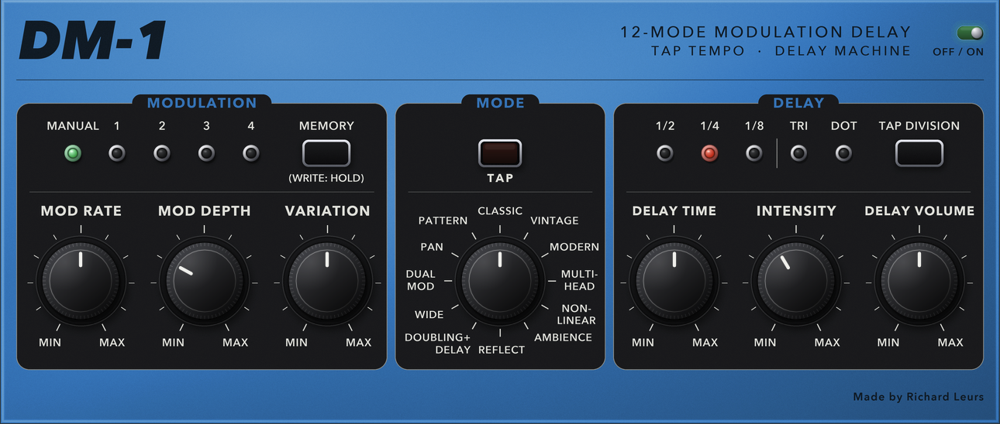

Are you interested in audio plugins and want to help improving and expanding the plugins then send me a message.

# VIBR Audio Plugins

A collection of Vintage effects pedals (and some new) redesigned as audio plugins (VST3, Audio Unit and Standalone), vibe coded with JUCE 8 and C++20.



### Delay & Echo

| Plugin | What it is |
|---|---|
| DD-1 Dual Delay | two delays + shimmer reverb, boost, chorus, hall reverb, 4 panel memories |
| DM-1 Delay Machine | 12-mode modulation delay, tap division, 4 panel memories |
| RE-1 Space Echo | tape echo + spring reverb, 12-position mode selector |
| RE-2 Space Echo | RE-1 engine + saturation, guitar / line, new / aged tape, 4 panel memories |
| MM-1 Analog Delay | analog-style delay, chorus and vibrato, overload lamp |
| SD-1 Digital Delay | digital delay: time, factor, regeneration, hi-cut, modulation, hold, headroom meter |
| SD-3 Digital Delay | programmable digital delay: 9 programs, filter, 5 waveforms, level balance |

### Modulation

| Plugin | What it is |
|---|---|
| CE-1 Chorus Ensemble | chorus / vibrato |
| BF-3 Flanger | stereo flanger: manual, res, depth, rate, 3 modes (standard, ultra, gate / pan) |
| PH-2 Phaser | phaser: rate, depth, res, 2 modes (4 or 8 stages) |

### Drive

| Plugin | What it is |
|---|---|
| DS-1 Distortion | stompbox distortion: tone, level, dist |
| OD-2 Hybrid Drive | 12 drive types, 3-band tone, boost, noise gate, 4 panel memories |

### Dynamics

| Plugin | What it is |
|---|---|
| CS-3 Compression Sustainer | compressor / sustainer: level, tone, attack, sustain |
| LM-2 Limiter | peak limiter: level, tone, release, threshold |

### EQ

| Plugin | What it is |
|---|---|
| GE-7 Equalizer | graphic equalizer: 7 bands (100 Hz - 6.4 kHz, +-15 dB) and a level fader |
| EH-2 Enhancer | treble enhancer: mix (inverting), freq, sens |

### Amp & Cabinet

| Plugin | What it is |
|---|---|
| IR-2 Amp & Cabinet | amp and cabinet: 11 amp types, gain, level, bass / middle / treble, ambience |

### Pitch

| Plugin | What it is |
|---|---|
| OC-5 Octave | vintage (monophonic) and poly octave: direct, +1 oct, -1 oct, -2 oct range |

### Reverb

| Plugin | What it is |
|---|---|
| BS-1 Reverb | 12 reverb types (room, hall, plate, spring, swell, bloom, cloud, chorale, shimmer, magneto, nonlinear, reflections) |

### Rhythm

| Plugin | What it is |
|---|---|
| SL-2 Slicer | rhythmic slicer: 11 patterns, 5 modes, tempo from the knob or the host |
| TR-8 Drum Machine | instrument: 11 voices or sampled kits, 16-step A/B sequencer, host sync |

### Multi effect

| Plugin | What it is |
|---|---|
| DC-1 Multi Effect | chain up to 8 of the pedals: add, remove, reorder and bypass; each pedal keeps its own front panel |

You can find the web page for the project on this [`website`](https://audio-plugins.richardleurs.nl).

## Build

### What you need

The build is set up for macOS (the copy and signing steps use `codesign`, `xattr` and `~/Library/Audio/Plug-Ins`).

| Tool | Version | How to get it |
|---|---|---|
| Xcode Command Line Tools (compiler, `git`, `codesign`) | recent | `xcode-select --install` |
| CMake | 3.22 or newer | `brew install cmake` ([Homebrew](https://brew.sh)), or the installer from [cmake.org/download](https://cmake.org/download/) |
| JUCE | 8.0.3 | see below |
| Python 3 with `numpy` and `Pillow` | only to re-render the front-panel artwork (`make_background.py`) | `pip install numpy pillow` |

**JUCE.** The plugins are written for JUCE 8.0.3 (C++20). The easiest way is to clone it once into `~/Developer/JUCE`, where the build finds it automatically:

```bash
git clone --depth 1 --branch 8.0.3 https://github.com/juce-framework/JUCE.git ~/Developer/JUCE
```

Keep it outside iCloud-synced folders such as `~/Documents`, where files can be evicted to the cloud and reads stall. If `~/Developer/JUCE` does not exist, CMake downloads JUCE 8.0.3 from GitHub by itself (`FetchContent`), which needs an internet connection and takes longer on a fresh build. You can point to another checkout with `cmake -DFETCHCONTENT_SOURCE_DIR_JUCE=/path/to/JUCE ...`.

**Signing (optional).** After each build the bundles are signed with a self-signed certificate if it exists in your login keychain; otherwise they get an ad-hoc signature, which is fine for your own machine.

### Building

The build on macOS is placed outside the iCloud synced folders in `~/Developer/Plugins-build`.

```bash
./build.sh              # everything
./build.sh DD-1 SD-3     # only these plugins
./build.sh --clean       # rebuild from scratch
```

`build.sh` configures and builds into `~/Developer/Plugins-build` (outside iCloud); it is a thin wrapper around:

```bash
cmake -S . -B ~/Developer/Plugins-build
cmake --build ~/Developer/Plugins-build --config Release -j8
```

One plugin: `--target DD-1_All` (or `DM-1_All`, `CE-1_All`, `RE-1_All`, `RE-2_All`, `DS-1_All`, `BF-3_All`, `CS-3_All`, `LM-2_All`, `PH-2_All`, `GE-7_All`, `EH-2_All`, `IR-2_All`, `DC-1_All`, `TR-8_All`, `SL-2_All`, `OD-2_All`, `OC-5_All`, `BS-1_All`, `MM-1_All`, `SD-1_All`, `SD-3_All`, ...).

## License

Copyright © 2026 Richard Leurs

This program is free software: you can redistribute it and/or modify it under the terms of the **GNU General Public License, version 3**, as published by the Free Software Foundation. It is distributed in the hope that it will be useful, but **without any warranty**; without even the implied warranty of merchantability or fitness for a particular purpose. See the [`LICENSE`](LICENSE) file for the full text.

The plugins are built with [JUCE 8](https://juce.com), used under its open-source licence (AGPLv3). The designs are inspired by classic hardware but are independent and carry no third-party branding; product names mentioned belong to their respective owners. The TR-08 sample kits are not part of this repository.
